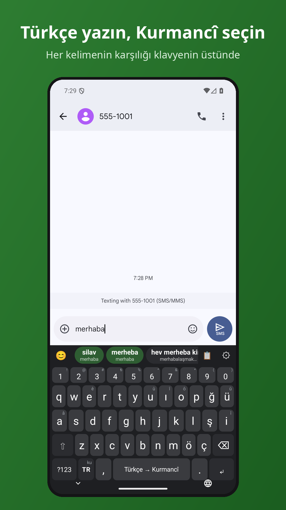
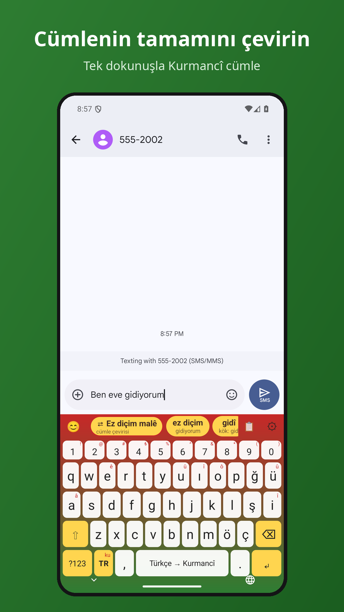
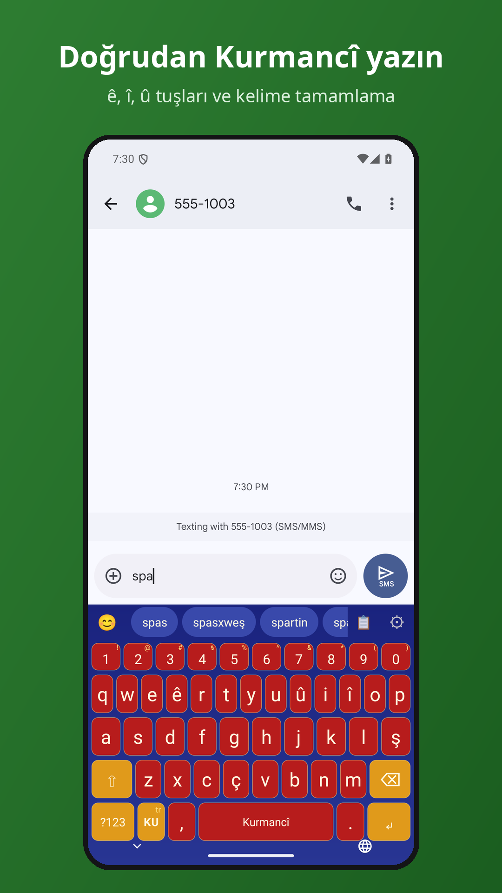
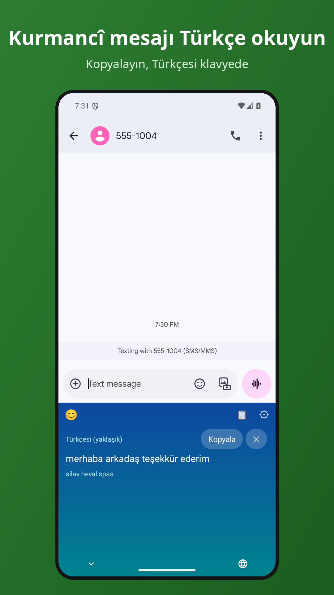
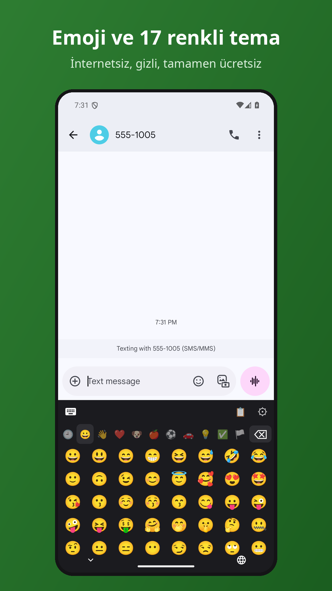

# Kurmancî Klavye

**Türkçe yazın, Kurmancî gönderin.** Tamamen çevrimdışı çalışan, Türkçeden Kurmancîye (Kuzey Kürtçesi) çeviri yapan bir Android klavyesi.

*Type in Turkish, send in Kurmanji — a fully offline Android keyboard that translates Turkish to Kurmanji (Northern Kurdish) as you type.*

<p align="center">
  
  
  
  
  
</p>

- 📲 Google Play: *Kurmancî Klavye: Türkçe Çeviri* (incelemede)
- 🔒 [Gizlilik politikası](https://helgurt574-cpu.github.io/kurmanci-klavye-gizlilik/)
- 📦 Sürümler: [Releases](../../releases)

---

## Türkçe

### Ne işe yarar?

Kurmancî konuşan ama Kurmancî yazmakta zorlanan, Türkçe klavyeye alışmış insanlar için yapıldı. Türkçe yazdıkça her kelimenin Kurmancî karşılığı klavyenin üstündeki öneri şeridinde çıkar; dokununca yazdığınız kelime Kurmancîsiyle değişir. İnternet gerekmez, yazdıklarınız telefonunuzdan hiçbir yere gitmez.

### Özellikler

**Türkçe → Kurmancî**
- 65.000'den fazla kelime ve kalıp içeren çevrimdışı sözlük
- Türkçe ekleri tanır: "evlerde" → mal, "kitabı" → pirtûk
- Türkçe harfsiz yazımı anlar: "guzel" → güzel → xweşik
- **⇄ Cümle çevirisi:** "Ben eve gidiyorum" → "Ez diçim malê"; "Dün okula gittim" → "Ez duh çûm dibistanê"

**Kurmancî yazma modu**
- TR/KU tuşuyla Kurmancî alfabe düzeni: ê, î, û, ç, ş kendi tuşlarında
- Kurmancî kelime tamamlama: "spa" → spas, "hev" → heval; şapkasız yazınca da bulur

**Kurmancî → Türkçe**
- Kurmancî bir mesajı kopyalayın, klavye Türkçesini gösterir: "Silav, tu çawa yî?" → "Merhaba, nasılsın?"

**Kelimelerim**
- Bir öneriye uzun basıp çeviriyi düzeltin ya da yeni kelime ekleyin
- Klavye sık seçtiğiniz karşılıkları öğrenir ve öne alır

**Tam bir klavye**
- Emoji paneli (son kullanılanlarla), pano geçmişi, sayı satırı
- Boşlukta kaydırarak imleç taşıma, tuş önizlemesi, uzun basınca büyük harf kilidi
- 17 tema (Newroz, Kilim, Zagros, Kuzey ışıkları, Neon…), ayarlanabilir yükseklik ve titreşim

### Gizlilik

- Uygulamanın **internet izni yoktur**; hiçbir veri toplanmaz veya gönderilmez
- Ayarlar ve "Kelimelerim" yalnızca cihazda saklanır
- Pano geçmişi yalnızca bellekte tutulur, dosyaya yazılmaz; hassas işaretli kopyalar (şifreler) alınmaz
- Şifre alanlarında öneri gösterilmez

### Sınırlar

Çeviriler sözlük ve kurallarla yapılır, yapay zekâ ile değil; bu yüzden **yaklaşıktır**. Kurmancî isimlerin cinsiyeti bilinmediği için ezafe çoğunlukla eril (-ê) çıkar ve yalnızca ~45 yaygın fiil çekilebilir. Düzeltmeler çok değerli; [issue açın](../../issues) ya da `tools/tr_ku.txt` dosyasına pull request gönderin.

---

## English

**Kurmancî Klavye** is an Android input method for people who speak Kurmanji but are used to typing Turkish. As you type Turkish, the Kurmanji translation of each word appears in the suggestion strip; tap it to replace the word. A ⇄ chip translates the whole sentence. Everything runs on-device: the app has no internet permission.

Features: 65k-entry offline Turkish→Kurmanji dictionary with suffix stripping and accent-insensitive lookup; rule-based sentence translation (verb conjugation, ergative past, motion-verb word order); a Kurmanji layout with word completion; Kurmanji→Turkish gist for copied text; user-editable dictionary that learns your picks; emoji, clipboard history, 17 themes.

Translations are rule-based and approximate — corrections are welcome.

---

## Geliştirme / Development

Gereksinimler: JDK 21, Android SDK (API 36). Harici bağımlılık yok (yalnızca testler için JUnit).

```bash
./gradlew assembleDebug          # → app/build/outputs/apk/debug/app-debug.apk
./gradlew testDebugUnitTest      # birim testleri / unit tests
./gradlew lintDebug
```

> `gradle.properties` içindeki `org.gradle.java.home` satırı geliştiricinin makinesine göredir; kendi JDK 21 yolunuza göre değiştirin ya da silin.

### Proje yapısı

| Dosya | Görevi |
|---|---|
| `KurmanciIME.kt` | Klavye servisi: öneri şeridi, pano, çeviri paneli |
| `KeyboardView.kt` | Tuş düzenleri (Türkçe Q, Kurmancî, semboller, emoji), dokunma, önizleme |
| `Dictionary.kt` | Sözlük araması: kalıp, tam eşleşme, kök, önek; harfsiz arama; Kurmancî tamamlama |
| `Translator.kt` | Kural tabanlı Türkçe → Kurmancî cümle çevirisi |
| `ReverseTranslator.kt` | Kurmancî → Türkçe yaklaşık çeviri |
| `UserWords.kt` | "Kelimelerim" ve seçim sayıları |
| `Theme.kt` | Temalar ve ayarlar |
| `SettingsActivity.kt` | Ayarlar sayfası |
| `tools/` | Sözlük kaynakları ve üretim betikleri |
| `store/` | Play Store metinleri, görseller, gizlilik politikası |

### Sözlüğe katkı

Elle düzeltilmiş kelimeler `tools/tr_ku.txt` dosyasındadır ve her zaman önceliklidir. Biçim:

```
türkçe = kurmancî1|kurmancî2
```

Düzenledikten sonra `python3 tools/build_dictionary.py` çalıştırın.

## Lisans / License

- Kaynak kod / source code: [MIT](LICENSE)
- Sözlük verisi / dictionary data (`tools/tr_ku_wiktionary.txt`, `app/src/main/assets/tr_ku.tsv`): Wiktionary contributors, [CC BY-SA 4.0](https://creativecommons.org/licenses/by-sa/4.0/)
